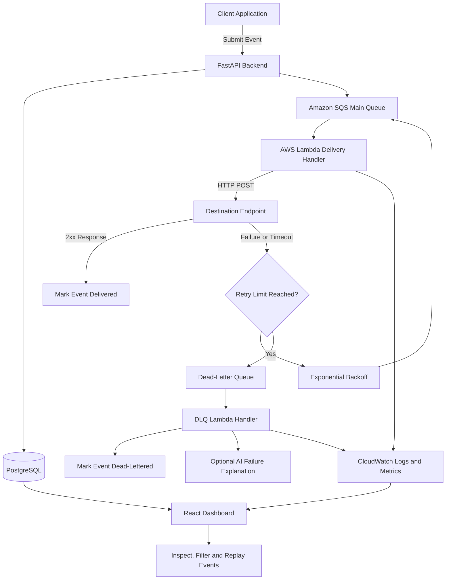

# QueueGuard 🚦
### AI-Assisted Webhook Reliability Platform

QueueGuard is a webhook delivery platform designed to make event delivery more reliable across distributed applications. It provides asynchronous processing, automatic retries, exponential backoff, idempotency, dead-letter handling, and delivery monitoring, with optional LLM-powered explanations for failed deliveries.

Instead of managing webhook failures manually, developers can register destination endpoints, submit events, track delivery attempts, and replay failed events through a centralized dashboard.

## ✨ Key Features

- **Reliable Webhook Delivery:** Process webhook events asynchronously using AWS SQS and Lambda.
- **Automatic Retries:** Retry failed deliveries with exponential backoff to handle temporary network failures and unavailable endpoints.
- **Idempotent Event Submission:** Prevent duplicate event creation using PostgreSQL constraints and idempotency keys.
- **Dead-Letter Queue (DLQ):** Isolate events that exhaust their retry attempts for investigation and recovery.
- **Delivery History:** Track event status, inspect delivery attempts, and replay failed events.
- **AI-Powered Failure Explanations:** Optionally use OpenAI to generate summaries of delivery failures.
- **Infrastructure as Code:** Provision AWS resources using Terraform.
- **Local Development:** Run the application using Docker Compose and LocalStack without requiring a live AWS account.

## 🏗️ Architecture



### Event Delivery Workflow

1. **Register an endpoint:** The client registers a destination URL through the FastAPI backend.
2. **Submit an event:** The client submits an event containing its type, payload, and optional idempotency key.
3. **Persist and enqueue:** The backend stores the event in PostgreSQL and sends it to the SQS main queue.
4. **Deliver asynchronously:** An AWS Lambda function consumes the queued event and sends an HTTP POST request to the destination.
5. **Handle failures:** Failed requests are retried using exponential backoff.
6. **Move exhausted events:** Events that exceed the configured retry limit are routed to the dead-letter queue.
7. **Investigate and recover:** The dashboard displays delivery history and supports replaying failed events. An optional AI component generates failure explanations.

## ⚙️ Technical Design Decisions

| Decision | Implementation | Rationale |
|---|---|---|
| Asynchronous processing | Amazon SQS + AWS Lambda | Separates event submission from delivery and allows delivery processing to scale independently. |
| Idempotency | PostgreSQL partial unique index | Prevents duplicate event creation for the same endpoint and idempotency key. |
| Retry strategy | Exponential backoff | Increases the delay between attempts to reduce repeated requests during temporary failures. |
| Dead-letter handling | SQS DLQ + Lambda | Separates events that exhaust their retries from normal delivery processing. |
| AI failure analysis | Optional OpenAI integration | Provides human-readable explanations to help developers investigate failures. |
| Infrastructure provisioning | Terraform | Makes AWS infrastructure configuration reproducible and version-controlled. |
| Local development | Docker Compose + LocalStack | Allows developers to test the application locally without a live AWS environment. |

### Retry Strategy

QueueGuard uses exponential backoff to space out retries:

`30s → 60s → 120s → 240s → 480s`

The delay is capped at 900 seconds, matching the SQS maximum delay for an individual message.

### Delivery Guarantees and Idempotency

QueueGuard follows an **at-least-once delivery model**, meaning a destination may receive the same event more than once.

To prevent duplicate event creation, QueueGuard uses a PostgreSQL partial unique index on `(endpoint_id, idempotency_key)`. Repeated submissions with the same key return the original event rather than enqueueing another one.

Downstream services should also implement idempotent event processing because duplicate HTTP deliveries remain possible.

## 🛠️ Tech Stack

| Category | Technologies |
|---|---|
| Backend | Python, FastAPI, Pydantic |
| Database | PostgreSQL, SQLAlchemy, Alembic |
| Message Queue | Amazon SQS |
| Serverless Processing | AWS Lambda |
| Monitoring | Amazon CloudWatch |
| Infrastructure as Code | Terraform |
| Frontend | React, TypeScript, Vite |
| AI Integration | OpenAI API |
| Local Development | Docker, Docker Compose, LocalStack |
| Testing | pytest, SQLite for tests |

## 📁 Project Structure

```text
queueguard/
├── app/
│   ├── models/             # SQLAlchemy ORM models
│   ├── schemas/            # Pydantic request/response schemas
│   ├── services/           # Business logic and integrations
│   ├── routers/            # FastAPI route handlers
│   ├── config.py           # Application configuration
│   ├── database.py         # Async database engine and sessions
│   └── main.py             # Application entry point
├── alembic/                # Database migrations
├── lambda/
│   ├── handler.py          # Webhook delivery processor
│   ├── dlq_handler.py      # Dead-letter queue processor
│   ├── ai_explainer.py     # Optional AI failure explanations
│   ├── cloudwatch_logger.py
│   └── db.py               # Synchronous database sessions
├── terraform/
│   ├── sqs.tf              # Main queue and DLQ
│   ├── lambda.tf           # Lambda functions and mappings
│   ├── iam.tf              # IAM execution roles
│   └── cloudwatch.tf       # Logs, metrics and alarms
├── frontend/
│   └── src/
│       ├── api/            # Typed API client
│       ├── pages/          # Dashboard pages
│       └── components/     # Reusable UI components
├── tests/                  # pytest test suite
├── scripts/                # LocalStack initialization and packaging
├── docker-compose.yml
├── pyproject.toml
└── .env.example
```

## 🚀 Getting Started

### Prerequisites

- Docker Desktop
- Python 3.11+
- Node.js 20+

### 1. Clone the Repository

```bash
git clone https://github.com/riyaa2210/QueueGuard.git
cd QueueGuard
```

> Replace the repository URL with your actual GitHub repository URL if the repository name or capitalization differs.

### 2. Configure Environment Variables

```bash
cp .env.example .env
```

Update `.env` if required. Use a strong, randomly generated application secret, and never commit real credentials or API keys.

The default configuration is intended for local development with Docker Compose and LocalStack.

### 3. Start the Application

```bash
docker compose up --build
```

Once the services start, the application components should be accessible at:

| Service | Address |
|---|---|
| FastAPI Backend | `http://localhost:8000` |
| Interactive API Documentation | `http://localhost:8000/docs` |
| React Dashboard | `http://localhost:5173` |
| PostgreSQL | `localhost:5432` |
| LocalStack | `http://localhost:4566` |

The backend runs database migrations during startup according to the project's configured startup process.

### 4. Run the Backend Without Docker

Create and activate a virtual environment:

```bash
python -m venv .venv
```

On Windows:

```powershell
.venv\Scripts\Activate.ps1
```

On macOS or Linux:

```bash
source .venv/bin/activate
```

Install the project and development dependencies:

```bash
pip install -e ".[dev]"
```

Start PostgreSQL and LocalStack separately, or configure the database and AWS endpoints for your environment.

Apply database migrations and start the API:

```bash
alembic upgrade head
uvicorn app.main:app --reload
```

### 5. Run Tests

```bash
pytest
```

Run a specific test file:

```bash
pytest tests/test_events.py
```

Run tests related to idempotency:

```bash
pytest -v -k "idempotency"
```

The test suite uses SQLite for faster execution. Some PostgreSQL-specific functionality may require separate integration testing.

## 📡 API Reference

QueueGuard exposes REST APIs for endpoint management, event submission, delivery tracking, and replay.

### Endpoint Management

| Method | Endpoint | Description |
|---|---|---|
| `POST` | `/api/v1/endpoints` | Register a destination endpoint |
| `GET` | `/api/v1/endpoints` | List registered endpoints |
| `GET` | `/api/v1/endpoints/{id}` | Retrieve an endpoint |
| `PATCH` | `/api/v1/endpoints/{id}` | Update endpoint details or active status |
| `DELETE` | `/api/v1/endpoints/{id}` | Delete an endpoint |

### Event Management

| Method | Endpoint | Description |
|---|---|---|
| `POST` | `/api/v1/events/{endpoint_id}` | Submit a webhook event |
| `GET` | `/api/v1/events/{endpoint_id}` | List events with pagination and filtering |
| `GET` | `/api/v1/events/detail/{event_id}` | Retrieve an event and its delivery attempts |
| `GET` | `/api/v1/events/detail/{event_id}/attempts` | List delivery attempts |
| `POST` | `/api/v1/events/detail/{event_id}/replay` | Replay a failed or dead-lettered event |

## 💻 API Usage Examples

### 1. Register a Destination Endpoint

```bash
curl -X POST http://localhost:8000/api/v1/endpoints \
  -H "Content-Type: application/json" \
  -d '{
    "url": "https://webhook.site/your-unique-id",
    "description": "My test webhook",
    "event_types": [
      "order.created",
      "payment.failed"
    ]
  }'
```

Save the returned endpoint ID for subsequent requests.

### 2. Submit a Webhook Event

```bash
curl -X POST http://localhost:8000/api/v1/events/<endpoint_id> \
  -H "Content-Type: application/json" \
  -d '{
    "event_type": "order.created",
    "payload": {
      "order_id": 1234,
      "amount": 99.99
    },
    "idempotency_key": "order-1234-v1"
  }'
```

QueueGuard persists the event and queues it for asynchronous delivery.

### 3. Test Idempotency

Submit the same event again using the same endpoint ID and idempotency key.

```bash
curl -i -X POST \
  http://localhost:8000/api/v1/events/<endpoint_id> \
  -H "Content-Type: application/json" \
  -d '{
    "event_type": "order.created",
    "payload": {},
    "idempotency_key": "order-1234-v1"
  }'
```

A duplicate submission returns HTTP `200` with the original event rather than creating another event.

### 4. Inspect Delivery History

Retrieve events for an endpoint, filtering by status where supported:

```bash
curl \
  "http://localhost:8000/api/v1/events/<endpoint_id>?status=failed&page=1&page_size=20"
```

### 5. Replay a Failed Event

```bash
curl -X POST \
  http://localhost:8000/api/v1/events/detail/<event_id>/replay
```

Use the returned response to verify that the event was accepted for replay.

## ☁️ AWS Deployment

QueueGuard uses Terraform to define its AWS infrastructure.

### 1. Package the Lambda Functions

From the repository root:

```bash
bash scripts/package_lambda.sh
```

The script generates the Lambda deployment package at:

```text
lambda/queueguard_lambda.zip
```

### 2. Configure Terraform

```bash
cd terraform
cp terraform.tfvars.example terraform.tfvars
```

Configure the required infrastructure variables, including the AWS region and database connection settings.

### 3. Provision the Infrastructure

```bash
terraform init
terraform plan
terraform apply
```

Review the execution plan before applying infrastructure changes to an AWS account.

The Terraform configuration provisions:

- An SQS main queue and dead-letter queue.
- Lambda functions for delivery processing and dead-letter handling.
- SQS event source mappings for the Lambda consumers.
- IAM execution roles and permissions.
- CloudWatch log groups, metric filters, and alarms.

### 4. Deploy the Backend

Deploy the FastAPI backend to a suitable Python hosting environment, such as Amazon ECS, AWS App Runner, or Amazon EC2.

Configure environment variables and secrets through the hosting platform. Ensure the backend, Lambda functions, database, and SQS queues use compatible configuration values and network permissions.

**Important:** Terraform infrastructure provisioning and application deployment are separate steps. Configure and verify both before sending production traffic.

## 🔐 Environment Variables

| Variable | Purpose |
|---|---|
| `DATABASE_URL` | Asynchronous PostgreSQL connection URL |
| `SYNC_DATABASE_URL` | Synchronous database URL for migrations and Lambda |
| `AWS_REGION` | AWS deployment region |
| `SQS_WEBHOOK_QUEUE_URL` | Main SQS queue URL |
| `SQS_DLQ_URL` | Dead-letter queue URL |
| `LOCALSTACK_ENDPOINT` | LocalStack endpoint for local development |
| `MAX_RETRY_ATTEMPTS` | Maximum configured delivery attempts |
| `INITIAL_RETRY_DELAY_SECONDS` | Initial retry delay |
| `DELIVERY_TIMEOUT_SECONDS` | HTTP delivery timeout |
| `OPENAI_API_KEY` | Optional key for AI failure explanations |
| `SECRET_KEY` | Application secret used by the backend |

Refer to `.env.example` for the expected configuration and default values.

## ⚠️ Known Limitations

- **At-least-once delivery:** Destination services must handle duplicate webhook requests safely.
- **Lambda cold starts:** The first invocation after inactivity may introduce additional latency.
- **Retry delay limits:** SQS message delays are limited to 15 minutes. Longer retry schedules require an additional scheduling mechanism.
- **Signature verification:** The current implementation does not include a complete HMAC signature verification flow.
- **Database testing:** SQLite-based tests do not cover every PostgreSQL-specific behavior.
- **Single-region deployment:** The current Terraform configuration targets a single AWS region.
- **AI explanation accuracy:** LLM-generated failure explanations may be incomplete or incorrect. Verify them against delivery logs and the original response.
- **Production hardening:** Authentication, authorization, endpoint validation, secret management, and other security controls should be reviewed before exposing the service to production traffic.

## 🔮 Potential Improvements

- Add HMAC-signed webhook requests and destination-side signature verification.
- Introduce configurable retry policies and longer scheduled retry intervals.
- Add per-endpoint delivery metrics, latency tracking, and success-rate analytics.
- Implement authentication, role-based access control, and audit trails for administrative operations.
- Add integration tests against PostgreSQL and AWS-compatible services.
- Support multi-region deployment and disaster recovery.
- Improve AI-generated failure explanations with structured error context and relevant delivery logs.

## 🎯 Project Goal

QueueGuard explores how backend engineering, asynchronous messaging, serverless computing, infrastructure as code, and optional AI-assisted diagnostics can work together to improve the reliability and observability of event-driven systems.

---

**Built with Python, FastAPI, PostgreSQL, AWS, Terraform, and React.**
